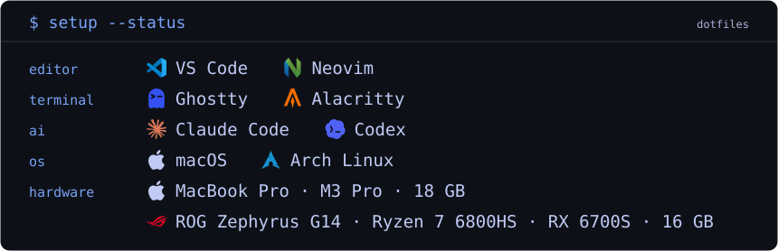
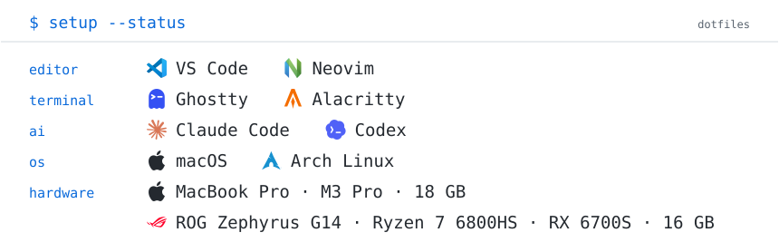

<a href="#gh-dark-mode-only">
<table width="100%"><tr><td><picture><source media="(max-width: 600px)" srcset="https://raw.githubusercontent.com/homeroresendiz/homeroresendiz/main/assets/readme/hybrid-session-mobile-top.svg"></picture><picture><source media="(max-width: 600px)" srcset="https://raw.githubusercontent.com/homeroresendiz/homeroresendiz/main/assets/readme/hybrid-session-mobile-setup.svg"></picture><picture><source media="(max-width: 600px)" srcset="https://www.homeroresendiz.com/api/v1/navidrome/now-playing.svg?theme=dark&amp;layout=mobile"></picture><picture><source media="(max-width: 600px)" srcset="https://www.homeroresendiz.com/api/v1/wakapi/language.svg?theme=dark&amp;layout=mobile"></picture><picture><source media="(max-width: 600px)" srcset="https://www.homeroresendiz.com/api/v1/xbox/activity.svg?theme=dark&amp;layout=mobile"></picture></td></tr></table>
</a>
<a href="#gh-light-mode-only">
<table width="100%"><tr><td><picture><source media="(max-width: 600px)" srcset="https://raw.githubusercontent.com/homeroresendiz/homeroresendiz/main/assets/readme/hybrid-session-mobile-light-top.svg"></picture><picture><source media="(max-width: 600px)" srcset="https://raw.githubusercontent.com/homeroresendiz/homeroresendiz/main/assets/readme/hybrid-session-mobile-light-setup.svg"></picture><picture><source media="(max-width: 600px)" srcset="https://www.homeroresendiz.com/api/v1/navidrome/now-playing.svg?theme=light&amp;layout=mobile"></picture><picture><source media="(max-width: 600px)" srcset="https://www.homeroresendiz.com/api/v1/wakapi/language.svg?theme=light&amp;layout=mobile"></picture><picture><source media="(max-width: 600px)" srcset="https://www.homeroresendiz.com/api/v1/xbox/activity.svg?theme=light&amp;layout=mobile"></picture></td></tr></table>
</a>
